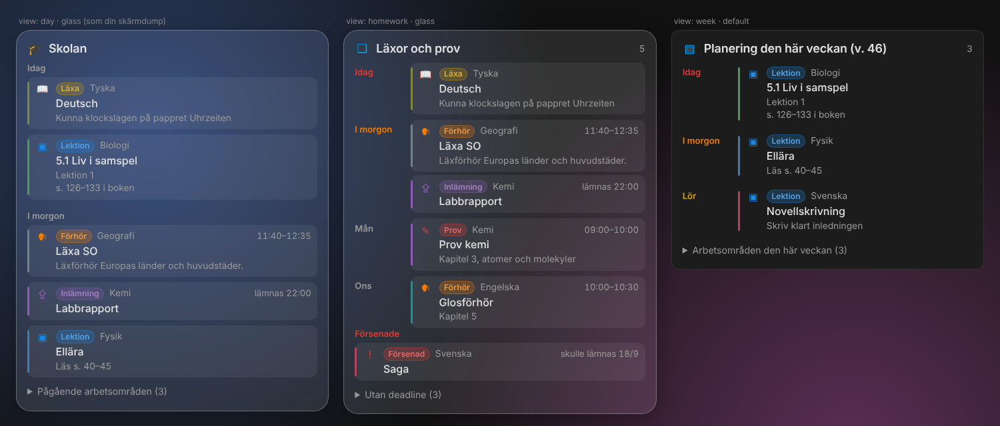
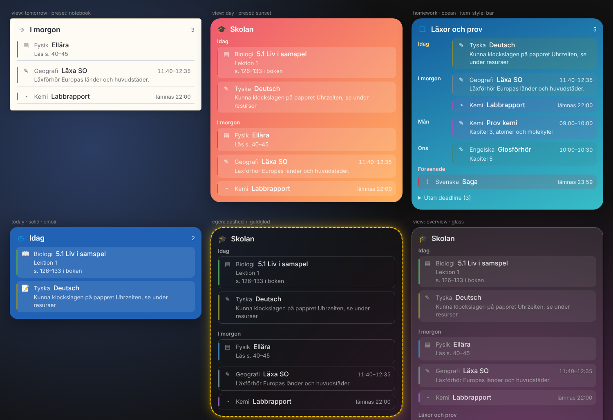

# itslearning för Home Assistant

Inofficiell Home Assistant-integration som hämtar läxor, deadlines och schema från itslearning, för skolor där eleven loggar in via **Skolfederation**. Byggd och testad för Nässjö kommun (`nassjo.itslearning.com` → Höglandsportalen), men flödet är generiskt.

Med i repot:
- **Integrationen** (`custom_components/itslearning`) med sensorer, två kalendrar och en synk-åtgärd.
- **En färdig skolpanel** för Lovelace (`lovelace/itslearning-dashboard.yaml`).
- **Ett paket** (`packages/itslearning.yaml`) med synk till Google Kalender.
- **Notiser** om nytt och dagliga läxpåminnelser, som blueprints.

> Inte kopplad till eller godkänd av itslearning AS eller Nässjö kommun. Den kan sluta fungera om itslearning eller kommunen ändrar sin inloggning.

## Entiteter

itslearning har inget lektionsschema, det ligger oftast i ett annat system som Skola24. Integrationen hämtar det som lärarna lägger in i itslearning:

| Entitet | Beskrivning |
|---|---|
| `sensor.itslearning_today` / `_tomorrow` | Allt för dagen: händelser, planering och deadlines (attributen `events`, `plans`, `tasks`). |
| `sensor.itslearning_upcoming_events` | Läxförhör, prov och andra händelser kommande 14 dagar. |
| `sensor.itslearning_plans_this_week` / `_next_week` | Lektionsplanering per kurs ("5.1 Liv i samspel – s. 126–133"), med arbetsområden i attributet `areas`. |
| `sensor.itslearning_work_areas` | Pågående arbetsområden, alltså planer som löper över flera veckor. |
| `sensor.itslearning_upcoming_tasks` | Uppgifter med deadline framåt. |
| `sensor.itslearning_due_tomorrow` | Uppgifter med deadline före midnatt i morgon. |
| `sensor.itslearning_overdue_tasks` | Ej klara uppgifter där deadline har passerat. |
| `sensor.itslearning_tasks_without_deadline` | Ej klara uppgifter utan deadline. |
| `sensor.itslearning_next_deadline` | Tidpunkt för nästa deadline. |
| `sensor.itslearning_news` | Nyheter från lärarna (antal senaste veckan, lista i `news`). |
| `sensor.itslearning_unread_notifications` | Olästa notiser. |
| `calendar.itslearning_events` | Händelser från itslearnings kalender. |
| `calendar.itslearning_plans` | Planering som heldagshändelser. |
| `calendar.itslearning_deadlines` | Deadlines (30 min, slutar vid deadline). |

Kurskoder översätts till ämnen, till exempel `BR7E/SV` → Svenska och `M2DEU/BR7` → Tyska. Data hämtas var 30:e minut. Med ett andra barn får entiteterna ändelsen `_2`.

## 1. Testa inloggningen

```bash
pip install aiohttp
python3 test_login.py            # Windows: py test_login.py
python3 test_login.py --debug    # visar varje steg
```

Skriptet visar uppgifter, händelser, planering och nyheter och testar att förnya token. `--explore` visar rådata från alla delar av API:et.

## 2. Installera integrationen

**HACS:** ⋮ → *Custom repositories* → `https://github.com/kakelakel/ITSlearning-Nassj-`, typ *Integration* → installera *itslearning* → starta om Home Assistant.

Sedan: *Inställningar → Enheter och tjänster → Lägg till integration → itslearning*.

## 3. Skolpanelen

*Inställningar → Instrumentpaneler → Lägg till instrumentpanel → Ny från början*. Öppna den, välj ⋮ → *Redigera* → ⋮ → *Raw-konfigurationsredigerare* och klistra in innehållet i `lovelace/itslearning-dashboard.yaml`.

Panelen visar:
- **Idag / I morgon:** läxförhör, prov, deadlines och dagens planering med beskrivning.
- **Planering denna vecka:** per veckodag. Nästa vecka ligger under en utfällbar rubrik.
- **Läxor & prov:** färg efter hur bråttom det är. Försenade visas i rött och uppgifter utan deadline ligger under en utfällbar rubrik.
- **Nyheter från lärarna.**
- **Kalender:** veckolista med händelser, planering och deadlines.
- **Google:** synka nu, och av/på för automatisk synk.

Panelen använder bara inbyggda kort.

## Kort till din egen panel

Integrationen har ett eget kort, `custom:itslearning-card`, som laddas automatiskt. Du behöver inte lägga till någon resurs eller installera något via HACS. Välj **Redigera panel → Lägg till kort**, sök efter **itslearning** och ställ in allt i den visuella editorn. Fler färdiga exempel finns i [`lovelace/card-examples.yaml`](lovelace/card-examples.yaml).




```yaml
type: custom:itslearning-card
view: homework
preset: glass
```

### Vyer (`view`)

| Värde | Visar |
|---|---|
| `day` | Idag och i morgon (standard). |
| `today` / `tomorrow` | En dag: händelser, deadlines och planering. |
| `homework` | Läxförhör, prov och deadlines, grupperat per dag. Visar även försenade och uppgifter utan deadline. |
| `week` / `next_week` | Lektionsplanering per dag. |
| `news` | Nyheter från lärarna. |
| `areas` | Pågående arbetsområden, alltså planer som löper över flera veckor. |
| `next` | En rad med nästa läxa eller prov. |
| `chips` | Snabbsiffror: i morgon, prov, försenade, nyheter, olästa. Tryck för detaljer. |
| `overview` | Allt i ett kort. |

### Kategorier

Varje rad får en etikett i egen färg, så att man ser vad det är:

| Etikett | Vad det är | Var det kommer ifrån |
|---|---|---|
| **Prov** | Prov, test, diagnos | Kalenderhändelser och uppgifter med "prov" eller "test" i namnet. |
| **Förhör** | Läxförhör, glosförhör | Kalenderhändelser med "förhör" eller "glosor". |
| **Läxa** | Något som ska läsas eller kunnas | Kalenderhändelser med "läxa", "kunna", "läs" eller sidhänvisningar ("s. 102"). |
| **Inlämning** | Uppgifter med deadline | Uppgifter i itslearning. |
| **Lektion** | Planering för en viss dag | Planering som gäller färre än 4 dagar. |
| **Arbetsområde** | Pågående område, t.ex. "Bröderna Lejonhjärta" | Planering som gäller 4 dagar eller mer. Visas under en egen utfällbar rubrik. |
| **Material**, **Anslag**, **Nyhet** | Nytt från lärarna | Nyhetsflödet ("har lagt till …", "nytt anslag"). |
| **Händelse** | Övrigt i kalendern | |

Inom en dag sorteras raderna i ordningen prov, förhör, läxa, inlämning, händelse och lektion. Kategorin finns också som attribut (`category`, `category_label`) på alla sensorer, och syns i kalendrarna och i Google-synken, till exempel "🗣️ Förhör: Geografi: Läxa SO".

### Stilar (`preset`)

`default` (följer ditt tema), `glass`, `neon`, `minimal`, `solid`, `notebook`, `sunset`, `ocean`, `midnight`. En stil är en startpunkt. Allt du ställer in själv skriver över den.

### Alla inställningar

Färger anges som `[r, g, b]`, `"#rrggbb"` eller en CSS-färg som `"var(--accent-color)"`.

| Inställning | Standard | Beskrivning |
|---|---|---|
| `title`, `icon` | per vy | Egen rubrik och ikon. |
| `show_header`, `show_count` | `true` | Rubrikrad och antal. |
| `show_events`, `show_tasks`, `show_plans` | `true` | Vad som tas med. |
| `show_overdue`, `show_no_deadline` | `true` | Extra delar i `homework`. |
| `show_description`, `description_lines` | `true`, `2` | Beskrivningar och hur många rader de får ta. |
| `show_subject_color`, `subject_bar_width` | `true`, `3` | Ämnesfärgad linje från itslearning. |
| `show_icons`, `icon_style` | `true`, `mdi` | `mdi` eller `emoji`. |
| `show_badges`, `badge_style` | `true`, `pill` | Etikett per rad: `pill`, `text` eller `none`. |
| `categories` | alla | Visa bara vissa, t.ex. `[test, quiz, homework]`. |
| `show_areas` | `true` | Arbetsområden som utfällbar rad under dag- och veckovyer. |
| `test_color`, `quiz_color`, `homework_color`, `assignment_color`, `event_color`, `lesson_color`, `area_color`, `material_color`, `bulletin_color`, `news_color` | | Färg per kategori. |
| `group_by_day` | `true` | Dagkolumn till vänster. |
| `link_items` | `true` | Rader öppnar itslearning. |
| `max_items`, `days_ahead` | `8`, `14` | Hur mycket som visas. |
| `empty_text` | – | Egen text när listan är tom. |
| `entity_suffix` | – | `_2` för ett andra barn. |
| `background_color`, `background_opacity` | tema, `100` | Bakgrund och täckning i procent. 0 betyder genomskinligt. |
| `blur` | `0` | Oskärpa bakom kortet (glas), i px. |
| `gradient`, `gradient_color`, `gradient_angle` | `false` | Gradient från bakgrundsfärgen. |
| `ruled` | `false` | Linjerat papper med marginallinje. |
| `text_color`, `secondary_text_color`, `accent_color` | tema | Textfärger och accent. |
| `font_scale` | `100` | Textstorlek i procent. |
| `border_width`, `border_style`, `border_color`, `border_opacity`, `border_radius` | tema | Kantlinje: `solid`, `dashed`, `dotted` eller `double`. |
| `shadow` | tema | Skuggans storlek, 0–80. |
| `glow`, `glow_color`, `glow_size`, `glow_intensity` | `false` | Glöd runt kortet. |
| `glow_animation` | `none` | `pulse`, `breathe` eller `rainbow`. Stängs av om enheten har reducerad rörelse påslagen. |
| `item_style` | `plain` | `plain`, `tinted`, `outlined` eller `bar` (tonad med ämnesfärg). |
| `item_background_opacity`, `item_radius`, `item_spacing`, `padding` | | Radernas utseende och avstånd. |
| `today_color`, `tomorrow_color`, `soon_color`, `later_color`, `overdue_color` | röd, orange, gul | Färg på dagkolumnen efter hur bråttom det är. |
| `chips` | alla | Vilka chips som visas, t.ex. `[tomorrow, overdue_tasks]`. |

## Notiser

Integrationen märker när något nytt dyker upp i itslearning och skickar då händelsen `itslearning_new`. Den följer med två färdiga **blueprints**, som installeras automatiskt under *Inställningar → Automationer → Blueprints*. Välj en blueprint, tryck *Skapa automation*, fyll i och spara.

### itslearning: notis om nytt

Skickar en notis för varje nytt prov, förhör, läxa, inlämning, ny eller ändrad deadline, nytt material, anslag och personlig notis, till exempel en ny bedömning.

- **Kategorier:** välj vilka som ska ge notis.
- **Bara om det gäller inom x dagar:** prov om två månader kan vänta.
- **Viktiga kategorier:** skickas med hög prioritet. Standard är prov och förhör.
- **Tysta timmar:** notisen väntar tills de är slut. Standard är 21–07.
- Ett tryck på notisen öppnar itslearning.

Första gången integrationen startar sparar den bara vad som redan finns, så du får inte en flod av gamla notiser. Den minns vad den har sett även efter en omstart.

### itslearning: påminnelse om läxor och prov

En daglig sammanfattning vid en tid och på veckodagar du väljer:

- **Inom x dagar:** till exempel kl. 18 om allt som gäller i morgon.
- **Exakt x dagar före:** till exempel "prov om 3 dagar". Skapa gärna en automation till med bara kategorin Prov.
- **Ta med idag:** bra för en morgonpåminnelse kl. 07.
- **Ta med försenade uppgifter.**

Exempel på notis:

```
Skolan – närmaste 7 dagarna
🗣️ I morgon: Förhör Geografi – Läxa SO (11:40–12:35)
📝 Lördag 14/11: Prov Kemi – Prov kemi (09:00–10:00)
📤 Söndag 15/11: Inlämning Kemi – Labbrapport (lämnas 22:00)
⚠️ Försenad: Svenska – Saga
```

Mottagaren anges som en notify-åtgärd, till exempel `notify.mobile_app_annas_telefon`. Vill du skicka till flera telefoner, skapa en [notify-grupp](https://www.home-assistant.io/integrations/group/#notify-groups).

### Egna automationer

Händelsen `itslearning_new` innehåller `kind`, `category`, `category_label`, `subject`, `title`, `description`, `url`, `date`, `day`, `days_left`, `time` och `child`. `kind` är `task`, `deadline`, `event`, `plan`, `news` eller `notification`.

```yaml
triggers:
  - trigger: event
    event_type: itslearning_new
    event_data:
      category: test
actions:
  - action: light.turn_on
    target: { entity_id: light.kontoret }
    data: { color_name: red, flash: short }
```

## 4. Google Kalender

1. Lägg till Home Assistants integration **Google Calendar** och ge den läs- och skrivrättighet. Skapa gärna en egen Google-kalender, till exempel "Freja skola", och välj den.
2. Kopiera `packages/itslearning.yaml` till `config/packages/`. Lägg också till detta i `configuration.yaml` om det inte redan finns:
   ```yaml
   homeassistant:
     packages: !include_dir_named packages
   ```
3. Byt `calendar.DIN_GOOGLE_KALENDER` i filen och starta om.

Synken körs varje timme och lägger bara till **nya** händelser. Varje händelse får en markering `[itsl:…]` i beskrivningen, så den läggs aldrig in två gånger. Som standard synkas deadlines och händelser (läxförhör, prov). Ta bort `#` framför `- plans` om även planeringen ska in.

Begränsning: Home Assistant kan inte ta bort eller flytta händelser i en annan kalender. Om en lärare flyttar en deadline läggs den nya tiden in, men den gamla ligger kvar tills du tar bort den.

Åtgärden kan också köras för hand under *Utvecklarverktyg → Åtgärder → itslearning: Synka till kalender*.

## Hur inloggningen fungerar

Integrationen gör samma sak som itslearning-appen:

1. Öppnar itslearnings OAuth-inloggning och väljer **Logga in med Skolfederation**.
2. Väljer **Användarnamn och lösenord** i Höglandsportalen och skickar uppgifterna.
3. Följer SAML-svaret tillbaka till itslearning och läser app-koden som sidan lämnar över med JavaScript.
4. Byter koden mot en åtkomsttoken och en förnyelsetoken.

Förnyelsetoken sparas, så hela inloggningen görs bara när den slutar gälla. Användarnamn och lösenord sparas lokalt i Home Assistant. BankID och SMS stöds inte.

## Felsökning

```yaml
logger:
  logs:
    custom_components.itslearning: debug
```

- **Inloggningen misslyckas:** kör `test_login.py --debug` och se var det stannar.
- **Något saknas:** kör `test_login.py --explore` och se vad itslearning faktiskt skickar.
- **Statusvärden:** uppgifter räknas som klara när status är till exempel `Completed` eller `Submitted`.

## Licens

MIT
